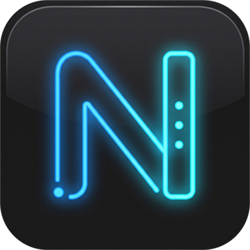
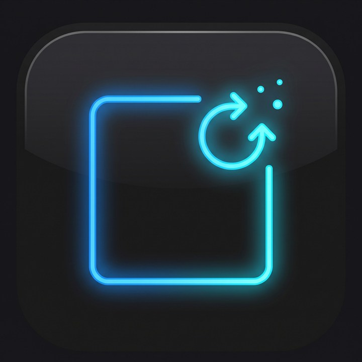
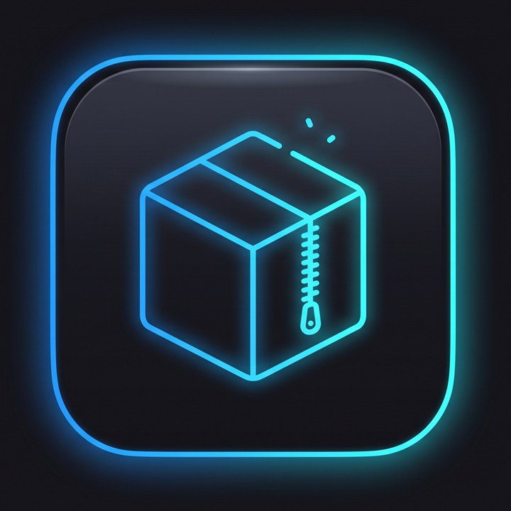
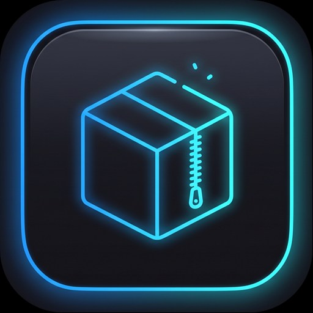

<p align="center">
  
</p>

<h1 align="center">NeoSuite</h1>

<p align="center">
  <b>Votre PC, sous contrôle.</b><br>
  Une suite d'applications Windows gratuites, sans compte et sans télémétrie, réunies dans un panneau qui s'ouvre avec <kbd>Ctrl</kbd> + <kbd>Alt</kbd> + <kbd>N</kbd>.
</p>

<p align="center">
  <a href="https://github.com/head69100/NeoSuite/releases/latest"></a>
  
  
  <a href="https://head69100.github.io/NeoSuite/"></a>
</p>

<p align="center">
  <a href="https://github.com/head69100/NeoSuite/releases/latest"><b>⬇ Télécharger NeoSuite</b></a> ·
  <a href="https://head69100.github.io/NeoSuite/">Site de présentation</a> ·
  <a href="NeoSuite/CHANGELOG.md">Nouveautés</a>
</p>

---

## Les applications

| | Appli | Ce qu'elle fait |
|---|---|---|
|  | **NeoSuite** | Le panneau latéral (<kbd>Ctrl</kbd>+<kbd>Alt</kbd>+<kbd>N</kbd>) : installe, met à jour et lance toutes les applis Neo. |
|  | **NeoDriver** | Mises à jour et installation des pilotes (Windows Update), informations matérielles façon CPU-Z. |
|  | **NeoUninstaller** | Désinstallation complète des programmes et de leurs restes, applis Windows préinstallées, démarrage, nettoyage façon CCleaner. |
|  | **NeoBoost** | Mode Boost, programmes gourmands et réglages de Windows qui accélèrent vraiment. |
|  | **NeoSoft** | Catalogue de logiciels : installe et met à jour vos logiciels depuis leurs sources officielles (winget). |
|  | **NeoRar** | Archives (moteur 7-Zip) : extraction, compression, volumes découpés, sauvegardes planifiées. |
|  | **NeoMedia** | Lecteur vidéo et audio (moteur VLC). |
|  | **NeoSound** | Duplique le son du PC vers deux casques en même temps (filaire + Bluetooth). |
|  | **NeoTorrent** | Lit les fichiers .torrent et les liens magnet, télécharge et partage. |

Chaque application est indépendante : NeoSuite peut en installer une seule, et chacune se désinstalle proprement.

## Installer

1. Téléchargez **[`NeoSuite.exe`](https://github.com/head69100/NeoSuite/releases/latest/download/NeoSuite.exe)** : un seul fichier.
2. Lancez-le et acceptez la confirmation de Windows.
3. Ouvrez le panneau avec <kbd>Ctrl</kbd> + <kbd>Alt</kbd> + <kbd>N</kbd> et cliquez sur les applications voulues : NeoSuite les télécharge depuis la dernière release de ce dépôt, puis les installe.

L'installateur ne contient que NeoSuite : il reste léger, et chaque appli arrive directement dans sa dernière version. Les applications s'installent dans `C:\Program Files\Neo\<App>`, avec une entrée dans « Applications installées » de Windows.

## Mises à jour automatiques

NeoSuite interroge la dernière release de ce dépôt :

- **la suite** : une nouvelle version s'affiche en haut du panneau, se télécharge et s'installe en un clic ;
- **les applis** : un paquet plus récent apparaît sur la tuile de l'appli (« Mettre à jour »), sans réinstaller toute la suite.

Aucun compte, aucune clé : le dépôt est public et seule l'API publique de GitHub est utilisée (`NeoSuite/Services/GitHubReleases.cs`).

## Versions

Chaque application a sa propre version, au format `MAJEUR.MINEUR.CORRECTIF` :

- **correctif** (0.1.0 → 0.1.1) : correction de bug, texte, détail visuel ;
- **mineur** (0.1.3 → 0.2.0) : nouvelle fonction, nouvel écran, nouveau réglage ;
- **majeur** (0.x → 1.0.0) : refonte ou changement incompatible.

Une **release GitHub** porte le tag `vX.Y.Z` de **NeoSuite** et contient tout :

| Fichier | Rôle |
|---|---|
| `NeoSuite.exe` | l'installateur (un seul fichier), qui installe NeoSuite |
| `<App>.zip` | le paquet de chaque application, téléchargé par NeoSuite / NeoSoft pour l'installer ou la mettre à jour |
| `catalog.json` | la version, la taille et l'empreinte SHA-256 de chaque paquet |

Les nouveautés de chaque appli sont dans son `CHANGELOG.md` : [NeoSuite](NeoSuite/CHANGELOG.md) · [NeoDriver](NeoDriver/CHANGELOG.md) · [NeoUninstaller](NeoUninstaller/CHANGELOG.md) · [NeoBoost](NeoBoost/CHANGELOG.md) · [NeoSoft](NeoSoft/CHANGELOG.md) · [NeoRar](NeoRar/CHANGELOG.md) · [NeoMedia](NeoMedia/CHANGELOG.md) · [NeoSound](NeoSound/CHANGELOG.md) · [NeoTorrent](NeoTorrent/CHANGELOG.md) · [Installateur](Setup/CHANGELOG.md).

## Compiler depuis les sources

Prérequis : Windows 10/11 x64, [SDK .NET 10](https://dotnet.microsoft.com/download), PowerShell 5.1.

```powershell
# Une appli, pour le développement
dotnet build NeoSuite\NeoSuite.csproj -c Debug -p:Platform=x64

# Paquet d'une appli (packages\<App>.zip + catalog.json)
powershell -ExecutionPolicy Bypass -File tools\build-packages.ps1 -Apps NeoDriver

# Installateur (un seul fichier : dist\NeoSuite.exe)
powershell -ExecutionPolicy Bypass -File tools\build-setup.ps1

# Publier la version sur GitHub (tag, notes, fichiers, version du site)
powershell -ExecutionPolicy Bypass -File tools\publish-release.ps1
```

## Organisation du dépôt

| Dossier | Contenu |
|---|---|
| `NeoSuite/` | le panneau, l'installation des applis et les mises à jour |
| `NeoDriver/`, `NeoUninstaller/`, `NeoBoost/`, `NeoSoft/`, `NeoRar/`, `NeoMedia/`, `NeoSound/`, `NeoTorrent/` | une appli par dossier (`src/<App>/`) |
| `Shared/Neo.Shared/` | le code commun : communication avec NeoSuite, instance unique, démarrage administrateur… |
| `Setup/NeoSetup/` | l'installateur |
| `NeoSite/` | le [site de présentation](https://head69100.github.io/NeoSuite/), publié automatiquement par GitHub Pages |
| `tools/` | scripts de construction et de publication |

Technologies : C# · .NET 10 · WinUI 3 (Windows App SDK) · Win32 · WMI · Windows Update Agent.

---

<p align="center">Conçu, écrit et testé en France · interface en français</p>
